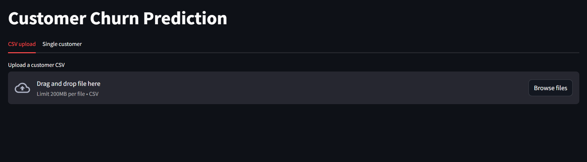
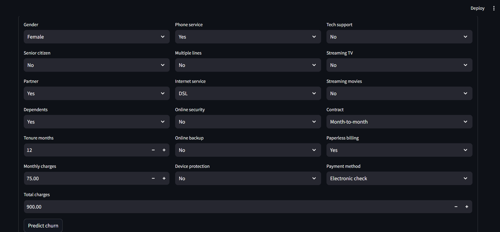

## Project Screenshots

### Customer Churn Prediction Dashboard


### SHAP Feature Contribution Chart


## 📌 Overview

End-to-end machine learning pipeline for predicting customer churn using **XGBoost, Random Forest, and Logistic Regression** with SHAP-based explainability. Identifies key drivers of customer attrition to enable proactive retention strategies.

## 📊 Model Performance

| Metric | Score |
|:---|:---|
| **Accuracy** | 87% |
| **ROC-AUC** | 0.89 |
| **Best Model** | XGBoost |

## 🔑 Key Features

- **Multi-model comparison**: XGBoost vs Random Forest vs Logistic Regression
- **SHAP explainability**: Feature importance and individual prediction explanations
- **End-to-end pipeline**: Data cleaning → Feature engineering → Modelling → Evaluation
- **Class imbalance handling**: SMOTE / class weight balancing
- **Visualizations**: ROC curves, confusion matrix, SHAP summary plots

## 📦 Dependencies

```
pandas
numpy
scikit-learn
xgboost
shap
matplotlib
seaborn
imbalanced-learn
jupyter
```
